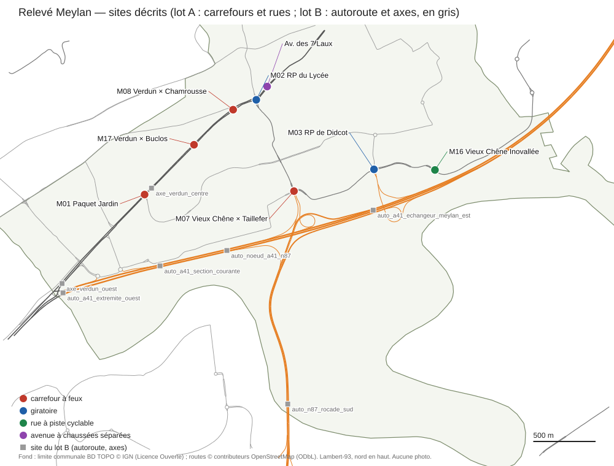

# Relevé de Meylan — index des sites (lot A : carrefours et rues)

*`recon/generateur/meylan/INDEX_SITES.md` — 17/10/2026. Relevé de Meylan pour le générateur procédural
(`../PLAN_GENERATEUR.md` § 6) : pour chaque site, des photos Panoramax récentes (regardées en tuiles natives), l'ortho IGN
20 cm, le levé topographique de la Métropole et OSM, puis (1) une **description en texte libre** comme l'utilisateur la
ferait et (2) sa **traduction en YAML** au format `../description/FORMAT_DESCRIPTION.md` + extension réseau
(`carrefours`, `giratoires`), chaque valeur avec sa provenance. Les sites du **lot B** (autoroute A41, rocade N87,
grands axes) sont les dossiers `auto_*` et `axe_*` : voir `LOT_B_AUTOROUTE_AXES.md`.*

Aucune photo ni tuile n'est versionnée : elles sont sous `recon/out/generateur/meylan/<site>/photos_non_versionnees/`
(ignoré par git). Les fichiers versionnés ne contiennent que des identifiants de photos, des dates, des positions, des
caps, des cotes et des constats.

## 1. Carte

`carte_sites.svg` (sans photo ; fond : limite communale BD TOPO, routes OSM ; régénérée par
`python -I outils_releve/carte_sites.py`, qui place aussi les sites du lot B en gris).

## 2. Sites du lot A

| Dossier | Site (dossier 13) | Type | État décrit (date des photos) | Photos retenues | Coupes | Ce qui est décrit |
|---|---|---|---|---|---|---|
| `paquet_jardin` | M01 | carrefour à feux en croix, Chronovélo, zone hachurée et TAG | **31/08/2025**, le plus récent (chantier du 23/06 au 05/12/2025) ; Revirée et Vercors : 18/05/2025 | 7 (6 du 31/08/2025, 1 du 18/05/2025) | 5 | Verdun 2 × 2, Revirée à îlot, Vercors 2 + 1, passages à feux, refuges, Chronovélo, option chantier |
| `verdun_centre_feux` | M17 | passage piéton à feux et baïonnette du chemin des Buclos | 28/07/2026 | 2 | 3 | Verdun 2 × 1 à zone hachurée de 3,7 m, refuge, deux T en cédez, Chronovélo et piste mixte |
| `verdun_lycee_feux` | M08 | carrefour à feux de chaussées séparées | 28/07/2026 | 3 | 4 | Verdun 3 + 1 et 2 + 2 avec îlots, Chamrousse (bande cyclable), Chaumetière, buttes plantées |
| `vieux_chene_taillefer_feux` | M07 | carrefour à feux à **îlots directionnels** (pied de l'Hélice) | 28/07/2026 | 3 | 4 | 4 branches à voies affectées, 2 tourne-à-droite directs en cédez derrière des îlots, traversées vertes |
| `vieux_chene_inovallee_piste` | M16 | **rue à piste cyclable séparée**, îlot peint ocre, T à feux | 28/07/2026 | 2 | 3 | 2 × 1 à îlot ocre, piste séparée vélos / piétons, traversée à figurines et chevrons |
| `rp_lycee` | M02 | **grand giratoire** (Ø 66 m, 5 branches) | 28/07/2026 | 5 | 5 + 4 radiales | anneau 8 m, couronne béton 1,5 m, îlot boisé surélevé, entrées à 2 voies, passages inférieurs |
| `rp_didcot` | M03 | **giratoire moyen** (Ø 47 m, 7 bras) | 28/07/2026 | 4 | 3 + 4 radiales | anneau 8,9 m, couronne en pavés rouges et galets, butte plantée, bretelle de la rocade |
| `avenue_7_laux_separateur` | — | **avenue à chaussées séparées** (RD1090) | 28/07/2026 | 2 | 2 | 2 chaussées à sens unique, séparateur de 1,5 m, piste, bande plantée, contre-allée |

Chaque dossier contient :

- `DESCRIPTION.md` : la description en texte libre (5 à 15 lignes, « environ »), l'**ordre de construction** proposé
  pour le PCG, les constats avec leur provenance, ce que la description simplifie ;
- `description.yaml` : la traduction au format existant ; provenance en fin de ligne (`coupe:<nom>`, `photo:<id>`,
  `osm:<way>`, règle `DEF-` / `RF-`), écarts aux règles des cas réels dans `ecarts_admis` avec leur preuve ;
- `photos.json` : identifiants Panoramax, dates, positions, caps, licences, producteurs, tuiles regardées, constats ;
- `mesures.json` : repère du site (origine L93 et z RGE ALTI), ortho, résumé OSM (voies et nœuds à 110 m), décompte du
  levé GAM, **coupes** (bandes et largeurs avec leur source), mesures du giratoire, constats.

## 3. Compilation (17/10/2026, 23 h ; compilateur du dépôt importé sans modification)

`python recon/generateur/description/description_vers_modele.py recon/generateur/meylan/<site>/description.yaml --sortie recon/out/generateur/meylan/<site>/compilation`

| Dossier | Tronçons | Sections | Carrefours | Îlots | Signaux | Marquages réseau | Écarts admis | Erreurs de validation | Non-conformités non admises | Part de valeurs dites |
|---|---|---|---|---|---|---|---|---|---|---|
| paquet_jardin | 4 | 9 | 1 | 3 | 12 | 12 | 4 | 0 | 0 | 53 % |
| verdun_centre_feux | 5 | 7 | 2 | 2 | 1 | 5 | 4 | 0 | 0 | 49 % |
| verdun_lycee_feux | 4 | 10 | 1 | 2 | 12 | 21 | 5 | 0 | 0 | 48 % |
| vieux_chene_taillefer_feux | 4 | 6 | 1 | 3 | 10 | 25 | 2 | 0 | 0 | 47 % |
| vieux_chene_inovallee_piste | 3 | 4 | 1 | 0 | 7 | 2 | 1 | 0 | 0 | 48 % |
| rp_lycee | 5 | 5 | 1 (giratoire) | 1 | 10 | 7 | 6 | 0 | 0 | 39 % |
| rp_didcot | 7 | 8 | 1 (giratoire) | 1 | 8 | 5 | 5 | 0 | 0 | 41 % |
| avenue_7_laux_separateur | 1 | 3 | 0 | 0 | 0 | 0 | 2 | 0 | 0 | 53 % |

« Part de valeurs dites » : provenances `description:` sur toutes les provenances du modèle (le reste vient des règles
`DEF-` / `RF-`, de la table du volet 12 et du solveur). Les écarts admis sont des cotes réelles hors des plages par
défaut (voies de 3,5 à 6,5 m, refuges étroits, séparateurs larges, bras de giratoire en entrée seule), chacun avec sa
coupe ou sa photo. Le compilateur et le solveur de carrefours évoluent (lot « étape 2 ») : relancer la compilation
après chaque livraison ; ce qui manque au format est dans `BESOINS_FORMAT.md` (A1 à A20).

## 4. Méthode et outils (`outils_releve/`, scripts versionnés ; sorties lourdes dans `recon/out/generateur/meylan/`)

| Étape | Commande | Sortie |
|---|---|---|
| Photos candidates (API STAC du méta-catalogue Panoramax, depuis le 01/01/2024, carré de 60 m ; 80 m pour M01) | `python -I outils_releve/pnx_site.py chercher SITE LON LAT --rayon 60` | `panoramax_candidats.json` (métadonnées, non versionné) |
| Téléchargement HD et tuiles natives (`decoupe.py equirect` à tangage −12° ou −15° pour les 360°, `decoupe.py image` pour les photos planes) | `python -I outils_releve/pnx_site.py telecharger SITE ID …` | `photos_non_versionnees/<id>.jpg`, `tuiles_<id>/` |
| Ortho IGN (WMS Géoplateforme `ORTHOIMAGERY.ORTHOPHOTOS`, 2024, 0,20 m natif ; ORTHO-EXPRESS 2025 et RVB-EXPRESS 2026 vides sur Meylan), altitude RGE ALTI | `python -I outils_releve/ortho_osm_site.py preparer SITE LON LAT --cote 160` | `ortho/` (+ tuiles natives), `mesures.json` → `repere`, `ortho` |
| OSM (extrait local du 09/10/2026, Overpass saturé le 17/10/2026), levé GAM et PCRS | `python -I outils_releve/plan_site.py extraire SITE` | `vecteurs/`, `mesures.json` → `osm`, `gam` |
| Plan annoté (ortho + bordures, marquages, arbres GAM, axes OSM, grille 10 m) | `python -I outils_releve/plan_site.py plan SITE --cote 100 --echelle 2` | `plan/` (≤ 1 092 px, sinon découpé) |
| Coupes en travers (intersections avec bordures, marquages, limites PCRS, axes OSM) | `python -I outils_releve/plan_site.py coupe --nom N SITE -- X0 Y0 X1 Y1` | `coupes/` ; reportées dans `mesures.json` → `coupes` |
| Constats et photos retenues | `python -I outils_releve/pnx_site.py retenir SITE ID …` puis `outils_releve/annoter.py SITE spec.json` | `photos.json`, `mesures.json` |
| Carte | `python -I outils_releve/carte_sites.py` | `carte_sites.svg` |

Toutes les images regardées l'ont été en tuiles natives (≤ 1 092 px) : 45 tuiles de photos citées dans les
`photos.json`, plans annotés et zooms d'ortho à 0,20 m natif (agrandis au plus proche voisin pour la lecture, l'ortho
brute restant à côté).

## 5. Couverture des catégories demandées

| Catégorie | Sites |
|---|---|
| carrefours à feux | paquet_jardin, verdun_lycee_feux, vieux_chene_taillefer_feux, vieux_chene_inovallee_piste, verdun_centre_feux (passage à feux) |
| carrefours avec îlots directionnels | vieux_chene_taillefer_feux (2 tourne-à-droite directs) ; îlots séparateurs : paquet_jardin, verdun_lycee_feux |
| giratoires | rp_lycee (grand, 66 m), rp_didcot (moyen, 47 m) |
| rues avec piste cyclable ou Chronovélo | vieux_chene_inovallee_piste (piste séparée), paquet_jardin et verdun_centre_feux (Chronovélo), avenue_7_laux_separateur (piste + contre-allée) |
| avenues avec terre-plein | avenue_7_laux_separateur (séparateur bordé), verdun_lycee_feux (îlots plantés), paquet_jardin (zone hachurée et refuges) ; le lot B couvre les TPC enherbés et à haie (`axe_verdun_ouest`) |
| carrefour Paquet Jardin / avenue de Verdun dans son état le plus récemment photographié | paquet_jardin : **31/08/2025** (aucune photo publique plus récente à 80 m le 17/10/2026) |

## 6. Recouvrements avec le lot B

- `verdun_centre_feux` (M17) est sur le tronçon décrit par `axe_verdun_centre` (lot B) : le lot A décrit le passage à
  feux et la baïonnette, le lot B l'axe courant.
- `vieux_chene_taillefer_feux` est le carrefour d'arrivée de l'Hélice de Meylan, dont la bretelle est décrite par
  `auto_noeud_a41_n87` (lot B) ; `rp_didcot` reçoit la bretelle de la rocade (« trunk_link » au sud).
- Les repères diffèrent : lot A, origine au centre de chaque site ; lot B, origine sur la médiane OSM au début du site.
  Un assemblage de Meylan devra ramener toutes les descriptions à un repère commun (L93 des `mesures.json`).

## 7. Limites

- **État 2026 et ortho 2024** : les photos datent du 28/07/2026, l'ortho et le levé GAM sont plus anciens ; quand ils
  diffèrent, la photo prime (ex. M16 : enrobé refait, traversée verte remplacée par des figurines et chevrons).
- **M01** : pas de photo de l'état fini (après le 05/12/2025) ; le 31/08/2025 montre un chantier. Le levé GAM du dépôt
  intègre déjà une partie du projet (Verdun sud-ouest) : il est utilisé seulement là où il recoupe l'ortho 2024.
- **Plans de feux** : jamais observables sur photo ; ceux des YAML sont des hypothèses à 2 phases (DEF-028), signalées
  en commentaire (besoin A6).
- **Largeurs non mesurées** (bras d'entrée de Didcot, trottoirs hors coupe) : prises sur photo ou laissées à la règle
  (DEF-004), dites dans les commentaires.
- **Hauteurs** (bordures, panneaux, murets) : estimées sur photo (± 0,2 à 0,4 m), jamais mesurées.
- Les espèces d'arbres ne sont pas identifiées (non fiable sur photo, dossier 13 § 6).

## 8. Suite proposée

1. Relancer la compilation à chaque livraison du lot « étape 2 » et fabriquer les huit scènes (L1-L2), puis comparer
   les rendus aux photos des `photos.json` (protocole de `PLAN_GENERATEUR.md` § 5).
2. Ajouter au format les besoins A1 (traversée revêtue automatique), A2 (traversée cyclable de branche), A6 (plan de
   feux supposé) et A7 (provenance par valeur), les plus fréquents.
3. Étendre le relevé : mini-giratoire (M05), STOP (M19, M20), îlot refuge (M23, M24), autres carrefours à feux de la
   RD1090 (M09, M10, M12).
